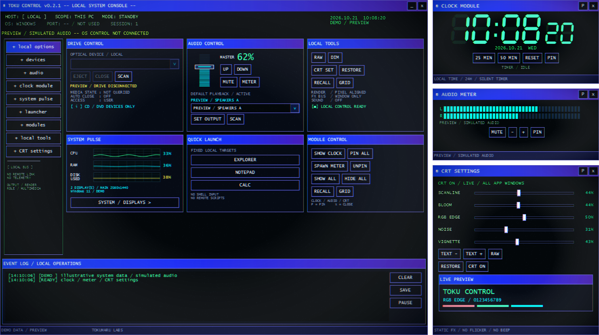
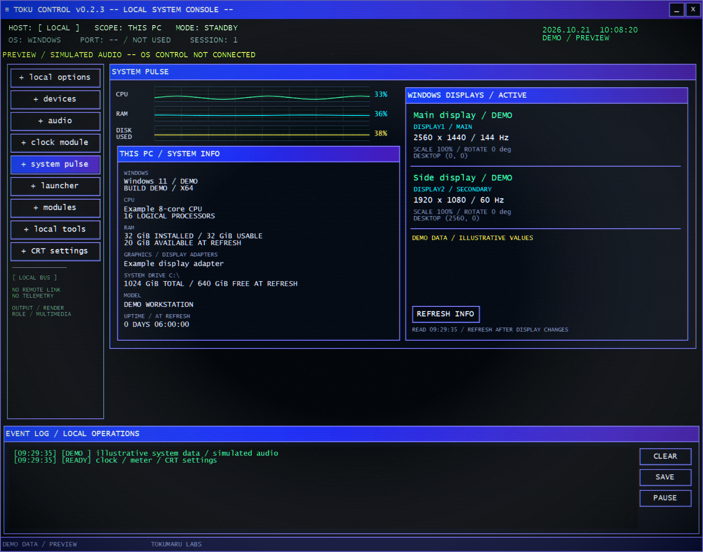

# TOKU CONTROL

**90年代のCRTデスクトップを思わせる、Windows用の小さなローカル操作盤。**

[English](README.md) · [ダウンロード](https://github.com/tokumaru-labs/toku-control/releases/latest) · [GPL-3.0](LICENSE)

*実際のWPF画面をプレビューモードで描画。紹介画像のPC情報・音声データはデモ値です。*

## 起動

1. [Releases](https://github.com/tokumaru-labs/toku-control/releases/latest)からWindows x64用のZIPを取得。
2. ZIPを**すべて展開**。
3. **一番上の `TokuControl.exe`** を起動。`Update.exe`・`current`フォルダーなど、展開したファイル一式を保持してください。

Windows x64用、Windows 11で検証。.NETを同梱し、追加インストール・ログイン・管理者権限は不要です。
初期公開版のためコード署名はありません。インストーラーは不要です。Windowsに発行元不明と表示される場合があります。
信頼できる配布元から取得し、必要に応じて同梱のSHA-256チェックサムと照合してください。

## できること

| 区画 | 操作 |
| --- | --- |
| AUDIO CONTROL | 再生音量・ミュート。出力先を選び `SET OUTPUT` で既定出力を切替。`SCAN` で再検出。 |
| CLOCK MODULE | 液晶時計、分数ホイール、残り時間バーと、休憩で育つねむまるのハッカー部屋。 |
| AUDIO METER | 再生デバイスのピーク表示。対応機器ではL/R。周波数スペクトラムやアプリ別ミキサーではありません。 |
| SYSTEM PULSE | CPU・RAM履歴、システムドライブ容量使用率。PC仕様とモニターの名前・解像度・Hz・拡大率・回転・位置。 |
| MODULE CONTROL | `SHOW ALL` / `GRID` / `RECALL` で、メイン右に時計・メーター・CRT設定を同じ幅で縦積み。 |
| CRT SETTINGS | 走査線・発光・色ずれ・ノイズ・減光を即時調整。`RAW` で効果OFF、`RESTORE` で初期値。 |
| DRIVE CONTROL | 光学ドライブの排出。トレイを閉じる操作は機種依存。 |
| QUICK LAUNCH | エクスプローラー・メモ帳・電卓・タスク マネージャー・従来のコントロール パネルの全項目一覧・タスク スケジューラ・スタートアップ アプリ設定・コマンド プロンプト・Windows PowerShellを起動。最後の2つは0.2.3で追加。 |
| EVENT LOG | 操作結果を表示。`SAVE` を押した時だけファイルへ保存。 |
| updates | 起動時に正式版の更新を確認。`+ updates`で手動確認・起動時確認のON/OFF。「YES / UPDATE」で取得・検証・更新・再起動。 |

時計・AUDIO METER・CRT設定は、各ボタンで表示／非表示を切り替えます。●は表示中、○は非表示または最小化中です。再表示すると位置とピン状態が戻ります。`+ modules` はもう一度押すとメイン画面に戻ります。

時計のホイールは**5～120分を5分刻み**で選べます。ホイール、上下ドラッグ／スワイプ、上下キー、前後の数字のクリックで選び、**START** で無音の休憩を開始します。残り時間とバーが進み、**RESET** で中断します。
休憩が完了すると、予定終了日のローカル日付に1日分だけ加算します。休まない日にも記録は減りません。部屋は0日「作業机」、1日「信号受信」、7日「解析ラック」、30日「秘密基地」。成長日数は365日まで記録します。
時計だけを隠す・閉じると計測は続きます。アプリ終了で進行中の休憩は終了し、完了済みの日数は設定場所の `nemumaru/growth-v1.json` に残ります。
保存に失敗した日は時計の「再保存」で回復できます。終了時にも再保存し、それでも失敗したときは時計へ戻るかを選べます。

メインのタイトルバーをドラッグすると、開始時にメインと重なる小窓、または上下左右の辺が整列時の隙間（12論理ピクセル）以内にある小窓が一緒に動きます。離して置いた小窓はその場に残り、メインの隣に戻すと次のドラッグから再び一緒に動きます。
`P` / `PIN` で最前面固定。メインの×は全体終了、小窓の×はその窓だけ閉じます。

Quick Launchは通常クリックで起動します。**コマンド プロンプト・Windows PowerShell・メモ帳・タスク マネージャー・タスク スケジューラ**は、ボタンを右クリック（またはフォーカスして `Shift+F10`）し、**「管理者として実行」**を選択できます。
WindowsのUAC確認・管理者資格情報の入力は、そのツールを起動する時だけ求められます。キャンセルしても本体は継続します。管理者起動の選択は保存せず、TOKU CONTROL本体には管理者権限を要求しません。
エクスプローラー・電卓・コントロール パネル・スタートアップ設定はWindows通常の起動動作を使い、管理者メニューはありません。
PowerShellはWindows標準搭載の **Windows PowerShell** を開きます（別途導入したPowerShell 7ではありません）。両シェルの開始場所はユーザーフォルダーです。プレビューモードではすべての起動を無効にします。

全体の整列にはタスクバーを除いて約 **1512×848論理ピクセル** が必要です。Windowsの拡大率が高いと、必要な物理ピクセル数も増えます。
収まらない場合は画面不足を表示するので、小窓を個別に利用してください。移動ではみ出した時は `SHOW ALL` で整列できます。

## 動作と制約

- **最初の移行だけ手動です。** v0.2.3以前には更新機能がないため、今回のZIPを新しいフォルダーへすべて展開して一番上のEXEを起動してください。設定は引き継がれ、次回以降はアプリ内から更新できます。旧版へ上書き展開しないでください。
- 起動時に新しい正式版があると「New version available」を表示。「YES / UPDATE」でダウンロード・検証後に更新して再起動します。「LATER」なら今回は更新しません。取得中は「CANCEL」で中止できます。`+ updates`で手動確認や起動時確認のOFFもできます。
- 更新には書き込み可能なローカルフォルダーと空き容量が必要です。他のTOKU CONTROLは終了してください。個人ファイルは、更新時に置き換わる`current`フォルダーへ入れないでください。通信失敗・キャンセル・ダウンロード検証失敗時は現在の版を継続できます。ファイルが使用中の場合、更新プログラムがエラーを表示して旧版を再起動することがあります。
- 更新ファイルはSHA-256で照合します。配布情報との整合性確認であり、発行元のコード署名ではありません。
- 通常再生用の既定出力（Console / Multimedia）を変更します。通話用・マイク・アプリ別出力は変更しません。
- 出力切替は非公開のWindows COMインターフェース `IPolicyConfig` を使用。Windows更新・環境による互換性は保証できません。失敗や復元確認の失敗は表示します。
- メーターはマスター音量・ミュートで減衰する前のピークが動く場合があります。
- `DISK USED` は容量使用率で、I/O負荷ではありません。グラフは1秒周期。詳細情報はスナップショットなので、モニター変更後は `REFRESH INFO` で再取得してください。
- 光学ドライブは読み書きが終わってから排出してください。APIの成功だけでは物理トレイの状態まで確認できません。CLOSE非対応の機器もあります。
- 倍率の異なる画面間のドラッグ、Windowsのスナップ・最大化を伴うドラッグ、長時間常駐、あらゆる機器の組合せは未検証です。

## ローカル保存・戻し方

アカウント・遠隔操作サーバー・アプリ独自の解析通信はありません。v0.3.0以降は更新確認のため公開GitHubリポジトリへHTTPSで接続します。起動時の確認は初期状態でON、`+ updates`からOFFにできます。ダウンロードは「YES / UPDATE」を押した時だけ行います。GitHubへIPアドレスなど通常の接続情報が伝わりますが、機器情報・音声データ・設定は送信しません。
Windows/.NETのエラー報告などはOS設定と提供元の条件に従います。

設定は `%LOCALAPPDATA%\TokumaruLabs\TokuControl\settings.json` に保存します。
位置・サイズ・固定・CRT設定を初期化するには、終了後にこのファイルを別の場所へ移してください。
アプリの削除は終了後に展開フォルダーを削除します。Windowsに反映した音量・ミュート・出力先は終了しても戻らないので、必要ならアプリまたはWindowsで戻してください。
ログ・スクリーンショットには機器情報が含まれる場合があります。共有前に内容を確認してください。
更新プログラムはローカルに診断ログを保存します。自動アップロードは行いません。

## Security Radar（レビュー中の機能）

**外部ニュースは別画面です。** 下記のRadarはローカル診断で、オンライン配信を取得しません。

左の **security radar** → **READ / REFRESH** で、このPCの保護状態、
永続化設定の変化、認証イベント、TCP/UDP接続を読み取ります。Attack Mapは
攻撃手法から取得根拠を逆引きできます。侵入判定や自動対処は行いません。
管理者権限・有料API・追加教材のダウンロードは不要です。
比較基準は手動で固定し、アプリ終了時に破棄します。取得失敗は未確認として表示します。
詳しい[取得範囲・限界・出典・検証方法](docs/SECURITY-RADAR.md)も参照してください。

## INTEL STREAM / 情報収集（レビュー中の機能）

左の **+ intel stream** を開き、読みたい情報源をチェックして **オンライン取得** をONにします。
選んだ配信だけをすぐに取得し、開いている間は15分間隔で更新します。見出しは約1.6秒ずつ流れます。
初回取得を途中で中止してすぐ選び直した場合は、表示された時刻（前回試行の1分後）から **更新** で再試行できます。
行を押すと表示が止まり、「原文を開く」や「☆ あとで読む」が使えます。HNは投稿日時、JPCERT/CCは配信・更新日時を表示します。

- **Hacker News**：[公式API](https://github.com/HackerNews/API)の上位24投稿からストーリーを取得。Windows・セキュリティ・AIなどの見出しを優先します。コミュニティの話題で、人気は正確さを保証しません。
- **JPCERT/CC**：[公式RSS](https://www.jpcert.or.jp/rss/)の注意喚起・週報。**Hugging Face Blog**：[ブログRSS](https://huggingface.co/blog/feed.xml)のモデル・研究・開発記事（コミュニティ投稿を含む）。
- **CACHE / 履歴**は情報源ごとに最大32件の見出し・リンク・取得日時、**★ あとで読む**は最大64件の見出しとリンクをこのPCだけに保持します。本文を読むには通信が必要です。失敗時は理由と前回取得分を区別します。
- チェックを外す・オンライン取得をOFFにする・画面を閉じると、該当する通信を中止します。再び開くとオンライン取得も各情報源もOFFです。ブラウザーで原文を開くまで、記事のリンク先にはアクセスしません。
- アカウント・有料API・管理者権限は不要です。設定場所の `intel/intel-library-v1.json` にニュースだけを保存します。診断ログやPCの構成を外部に送らず、ニュースを検知結果として扱いません。

## 開発・ライセンス

C# / WPF / .NET 10。`global.json` のSDKを使用し、`build.ps1` でビルド、`verify.ps1` で検証します。
詳細は [English README](README.md#build-and-verify) と [検証範囲](VERIFICATION.md) を参照してください。

Copyright (c) 2026 Tokumaru Labs。アプリ本体は **GPL-3.0-only**。
Microsoft製の.NETランタイムとのリンク・同梱に限る[追加許諾](LICENSE-NET-EXCEPTION)を付けています。
同梱ランタイムは提供元のライセンスを維持します。[第三者ライセンス](THIRD-PARTY.md)
