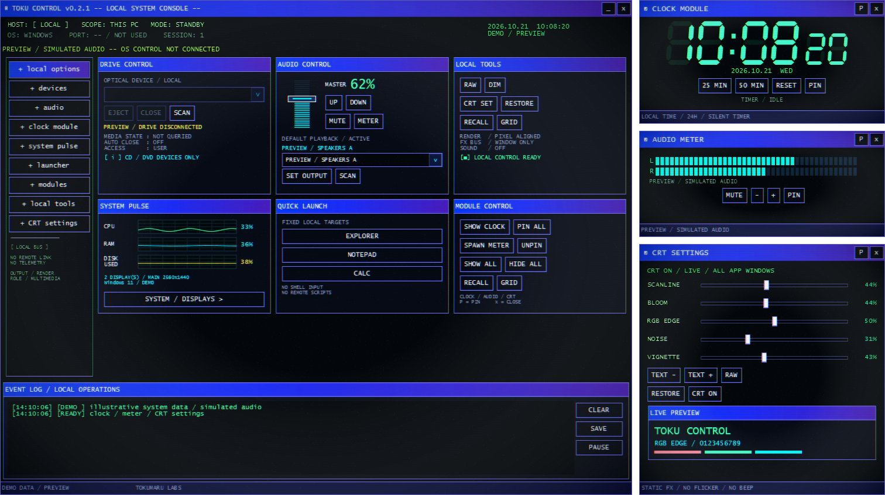
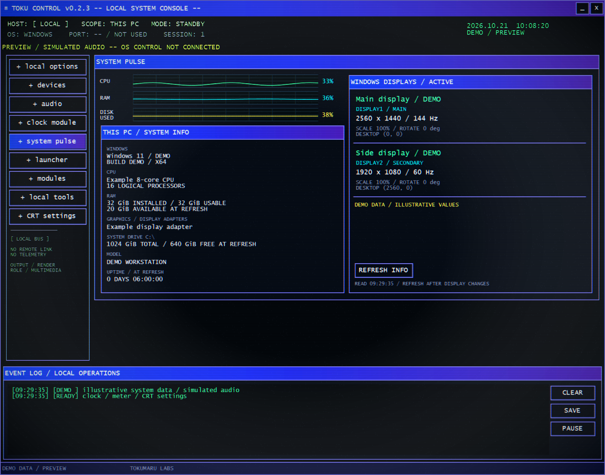

# TOKU CONTROL

**A small Windows control console with a 1990s CRT desktop feel.**

[日本語](README.ja.md) · [Download](https://github.com/tokumaru-labs/toku-control/releases/latest) · [GPL-3.0](LICENSE)



*Actual WPF rendering in preview mode. The screenshot uses illustrative system data and simulated audio.*

TOKU CONTROL puts playback volume, output switching, a digital clock, peak
meters, and Windows system/display information into a compact local console.
Blue title bars, green LCD digits and adjustable CRT effects are part of the interface.

## Run

1. Download the Windows x64 ZIP from [Releases](https://github.com/tokumaru-labs/toku-control/releases/latest).
2. Extract the **entire** ZIP into a folder.
3. Run the **top-level `TokuControl.exe`**. Keep `Update.exe`, `current/` and the other extracted files together.

Windows x64; tested on Windows 11. The portable build includes .NET, so no
separate runtime installation, account or administrator privileges are needed.
This early release is **unsigned** and needs no installer.
Windows may show an unknown-publisher warning. Only run a download whose source
you trust; release assets include a SHA-256 checksum file.

## Controls

| Area | What it does |
| --- | --- |
| Audio | Master playback volume, mute, device scan and explicit default output switching. Select an output, then press `SET OUTPUT`. |
| Clock | LCD time/date, a 5-minute-step duration wheel, countdown bar and a growing Nemumaru hacker room. |
| Audio meter | Endpoint peak levels, with stereo L/R where supported. This is a peak meter, not a spectrum analyzer or per-app mixer. |
| System pulse | CPU/RAM history, system-drive capacity use, Windows/build, CPU, RAM, graphics and active monitor details. |
| Modules | `SHOW ALL`, `GRID` and `RECALL` place the three equal-width modules in a vertical column to the right of the main window. |
| CRT | Live scanlines, bloom, RGB edge, noise and vignette. `RAW` disables effects; `RESTORE` restores their defaults. |
| Drives | Optical-drive eject; tray close only where supported by the hardware. |
| Launcher | Explorer, Notepad, Calculator, Task Manager, all classic Control Panel items, Task Scheduler, Startup Apps settings, Command Prompt and Windows PowerShell. The two shells are new in 0.2.3. |
| Event log | Operation results, with explicit export using `SAVE`. |
| Updates | Startup checks for new stable versions; `+ updates` opens manual checking and the startup-check preference. `YES / UPDATE` downloads, verifies, updates and restarts. |

In the Clock Module, use the selector above the artwork to switch between **部屋** (room) and **TRACE 端末** (terminal). The terminal diagram grows with your completed rest days at 0, 1, 7 and 30 days. Switching keeps the running timer and the earned days. The local console types a command on start, cancel and completion, then shows the actual timer or result. The node briefly lights up with the reply. Disable typing with the adjacent button or Windows animation preferences for an immediate readout.

Individual clock, audio meter and CRT buttons toggle their windows. A filled dot
means visible. Reopening restores the module's position and pin. Click `+ modules`
again to return to the main dashboard.
Dragging the main title bar moves only visible, normal modules that overlap the console
or lie alongside one of its edges within the 12-DIP layout gap at drag start.
A detached module stays put. Move it back beside the console to reattach it for
the next drag. `P` / `PIN` keeps a module on top.

Choose 5–120 minutes with the wheel, a vertical swipe or drag, the arrow keys, or a tap above or below the selected time.
**START** begins a silent break and **RESET** cancels it. The timer continues while the clock window is hidden or closed.
Completing a break earns at most one growth day per local finish date. The generated room art changes at days 1, 7 and 30.
Growth is stored locally up to day 365. Exiting the app ends an unfinished timer.
Closing the main window exits the application; closing a module only closes that module.

Click a Quick Launch button to open its tool normally. For **Command Prompt,
Windows PowerShell, Notepad, Task Manager and Task Scheduler**, right-click the
button (or focus it and press `Shift+F10`) and choose **Run as administrator**.
Windows handles UAC consent or administrator credentials; cancelling leaves the
console running. This choice applies to that launch only. The console itself
does not request elevation. Explorer, Calculator, Control Panel and Startup Apps
keep their normal Windows launch behavior and have no administrator menu.
PowerShell opens the built-in **Windows PowerShell**, not a separately installed
PowerShell 7. Both shells start in your user folder. Preview mode disables all launches.

The full arrangement needs approximately **1512 × 848 logical pixels** of work
area (more physical pixels at higher Windows scaling). If it cannot fit, the app
reports insufficient space. Modules can still be used individually. `SHOW ALL`
restores the arrangement if a group drag moves a module out of view.



*Demo values. Real use reads Windows and the active display configuration.*

## Local behavior and settings

TOKU CONTROL has no accounts, remote-control server or application analytics.
Starting with 0.3.0, update checks contact the public GitHub repository over HTTPS.
Checks run on startup by default and can be switched off in `+ updates`.
Downloads happen only after `YES / UPDATE`. GitHub receives normal connection
information such as your IP address; device/audio data and settings are not uploaded.
Windows/.NET services such as OS error reporting remain governed by the operating
system's settings and vendor terms.

Settings are stored in `%LOCALAPPDATA%\TokumaruLabs\TokuControl\settings.json`.
They contain window positions/sizes, pin state, appearance and the update-check preference.
Operation logs remain in memory unless you export them; the updater also writes
local diagnostic logs. Exported logs or screenshots can
contain device/system information; review them before sharing.

To reset appearance and window settings, exit the app and move `settings.json`
aside. To remove the app, exit and remove its extracted folder. Windows volume,
mute and default-output changes persist independently; switch them back in the
app or Windows if desired.

## Limits

- **First upgrade:** 0.2.3 and earlier do not contain the updater. Extract 0.3.0 or
  later into a new folder once, then start its top-level EXE. Existing settings
  carry over. Future updates use the in-app prompt. Keep personal files outside
  `current/`, which is replaced during updates. Do not extract over an older flat ZIP.
- Update packages are checked with SHA-256 before installation. This checks
  integrity against the official release feed; it is not a publisher code signature.
  A writable local folder and enough disk space are required. Close other copies
  of TOKU CONTROL before updating. Offline/rate-limited checks and cancelled or
  failed downloads leave the running version usable. File-lock problems may cause
  the updater to display an error and reopen the old version.
- Output switching changes the Console and Multimedia playback defaults, not
  the Communications default, microphone settings or per-app output overrides.
  It uses the undocumented Windows `IPolicyConfig` COM interface. Compatibility
  can change with Windows updates. Failures and unsuccessful rollback checks
  are reported in the UI.
- Audio peaks can be measured before master volume/mute attenuation; movement
  while muted is not necessarily an error.
- `DISK USED` is capacity use, not disk I/O activity. System graphs update every
  second. Detailed PC/display information is a snapshot; use `REFRESH INFO`
  after changing monitors or display settings.
- Optical tray commands do not prove physical tray position. Finish disc I/O
  before ejecting. Closing a tray is hardware-dependent.
- Mixed-DPI monitor transitions, Windows snap/maximize dragging, long-running
  sessions and all hardware combinations have not been exhaustively tested.

## Build and verify

Requires Windows and the .NET SDK pinned in `global.json` (10.0.402).

```powershell
powershell.exe -NoProfile -ExecutionPolicy Bypass -File .\build.ps1
powershell.exe -NoProfile -ExecutionPolicy Bypass -File .\verify.ps1
```

The portable build is written to `artifacts/portable`. Tests need an interactive
Windows desktop. Native checks read OS state; audio writes, routing and drive
actions are tested using the simulated backend. See [verification scope](VERIFICATION.md).

`package.ps1` uses pinned Velopack 1.2.161 to build the update-enabled portable ZIP,
full update package, release feed and checksums in `artifacts/release-v<version>`.
It requires fresh output directories. See [release/update instructions](UPDATING.md).

`--preview --data-dir "<temporary-folder>"` opens a simulated audio/device
console. Its clock and system panel normally still read live data.
`--gallery-dir "<output-folder>"`, together with those two arguments, renders
documentation screenshots with demo values and exits.

The CRT shader source and compiled shader are both included. After editing it:

```powershell
powershell.exe -NoProfile -ExecutionPolicy Bypass -File .\tools\Compile-CrtShader.ps1
```

This uses the Windows `d3dcompiler_47.dll`; no extra shader compiler package is required.

## Security Radar (review feature)

Intel Stream, below, is an independent opt-in news reader. The radar itself stays offline.

The **security radar** navigation opens a read-only, manual Windows inspection
window with an ATT&CK map, protection state, persistence comparisons,
authentication events and TCP/UDP snapshots. It needs no paid service or elevation.
See [coverage, limits, provenance and checks](docs/SECURITY-RADAR.md).

## Intel Stream (review feature)

Open **+ intel stream**, check the sources you want, then enable **オンライン取得**.
The window starts offline each time. It fetches only checked feeds: [Hacker News](https://github.com/HackerNews/API)
top stories, [JPCERT/CC](https://www.jpcert.or.jp/rss/) advisories and weekly reports, and the
[Hugging Face Blog](https://huggingface.co/blog/feed.xml) including community authors.
Checking feeds needs no API key or subscription. Headlines advance independently of fetching;
click one to pause, inspect the destination, open the original in your browser, or save it.

While enabled and open, each checked source refreshes every 15 minutes. Turning a source off,
disabling the reader, or closing the window cancels its requests. **CACHE** and **あとで読む**
work offline with locally stored headline metadata (up to 32 per source and 64 bookmarks).
Full articles open only on request; no article bodies, telemetry or PC diagnostics are transmitted
by the reader. News is not a finding about this computer. Failed fetches show their status and
the last successful fetch time separately. HN timestamps describe the submission, not necessarily publication.

## License

Copyright (c) 2026 Tokumaru Labs. GNU GPL version 3 only, with a narrow
[.NET runtime linking permission](LICENSE-NET-EXCEPTION). Bundled Microsoft
runtime components keep their own licenses; see [third-party notices](THIRD-PARTY.md).

Please report reproducible problems through [Issues](https://github.com/tokumaru-labs/toku-control/issues),
including the app/Windows version and steps, with private device information removed.
