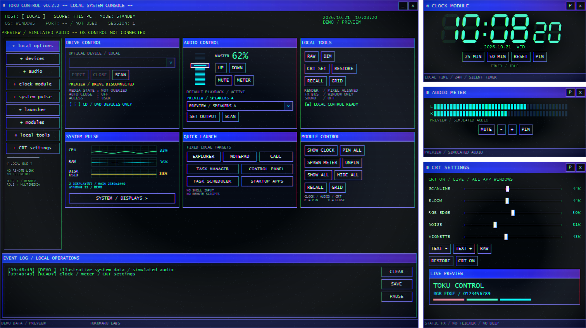
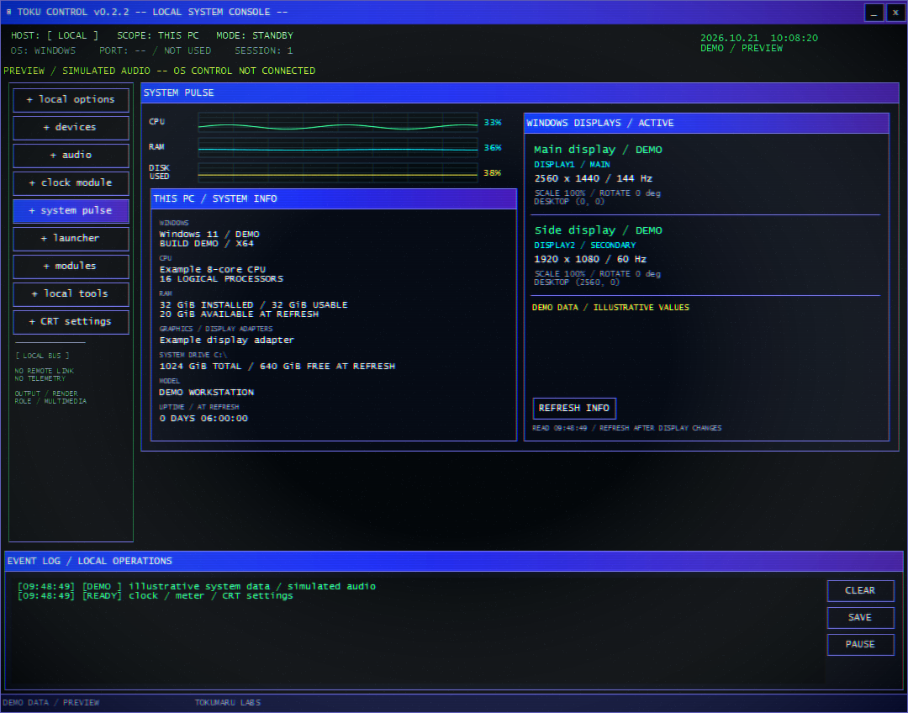

# TOKU CONTROL

**A small Windows control console with a 1990s CRT desktop feel.**

[日本語](README.ja.md) · [Download](https://github.com/tokumaru-labs/toku-control/releases/latest) · [GPL-3.0](LICENSE)



*Actual WPF rendering in preview mode. The screenshot uses illustrative system data and simulated audio.*

TOKU CONTROL puts playback volume, output switching, a digital clock, peak
meters, and Windows system/display information into a compact local console.
Blue title bars, green LCD digits and adjustable CRT effects are part of the interface.

## Run

1. Download the Windows x64 ZIP from [Releases](https://github.com/tokumaru-labs/toku-control/releases/latest).
2. Extract the **entire** ZIP into a folder.
3. Run `TokuControl.exe`. Keep its DLLs and license files beside it.

Windows x64; tested on Windows 11. The portable build includes .NET, so no
separate runtime installation, account or administrator privileges are needed.
This early release is **unsigned** and has no installer or automatic updater.
Windows may show an unknown-publisher warning. Only run a download whose source
you trust; release assets include a SHA-256 checksum file.

## Controls

| Area | What it does |
| --- | --- |
| Audio | Master playback volume, mute, device scan and explicit default output switching. Select an output, then press `SET OUTPUT`. |
| Clock | Large LCD-style hours/minutes, smaller seconds, date and silent 25/50-minute timers. |
| Audio meter | Endpoint peak levels, with stereo L/R where supported. This is a peak meter, not a spectrum analyzer or per-app mixer. |
| System pulse | CPU/RAM history, system-drive capacity use, Windows/build, CPU, RAM, graphics and active monitor details. |
| Modules | `SHOW ALL`, `GRID` and `RECALL` place the three equal-width modules in a vertical column to the right of the main window. |
| CRT | Live scanlines, bloom, RGB edge, noise and vignette. `RAW` disables effects; `RESTORE` restores their defaults. |
| Drives | Optical-drive eject; tray close only where supported by the hardware. |
| Launcher | Explorer, Notepad, Calculator, Task Manager, all classic Control Panel items, Task Scheduler and Startup Apps settings. The last four shortcuts are new in 0.2.2. |
| Event log | Operation results, with explicit export using `SAVE`. |

Drag the main title bar to move visible, non-minimized modules with it. Each
small window can also be moved independently. `P` / `PIN` keeps a module on top.
Closing the main window exits the application; closing a module only closes that module.

The full arrangement needs approximately **1512 × 848 logical pixels** of work
area (more physical pixels at higher Windows scaling). If it cannot fit, the app
reports insufficient space. Modules can still be used individually. `SHOW ALL`
restores the arrangement if a group drag moves a module out of view.



*Demo values. Real use reads Windows and the active display configuration.*

## Local behavior and settings

TOKU CONTROL has no accounts, remote-control server, application analytics or
application-initiated network requests. Windows/.NET services such as OS error
reporting remain governed by the operating system's settings and vendor terms.

Settings are stored in `%LOCALAPPDATA%\TokumaruLabs\TokuControl\settings.json`.
They contain window positions/sizes, pin state and appearance preferences.
Logs remain in memory unless you export them. Exported logs or screenshots can
contain device/system information; review them before sharing.

To reset appearance and window settings, exit the app and move `settings.json`
aside. To remove the app, exit and remove its extracted folder. Windows volume,
mute and default-output changes persist independently; switch them back in the
app or Windows if desired.

## Limits

- Output switching changes the Console and Multimedia playback defaults, not
  the Communications default, microphone settings or per-app output overrides.
  It uses the undocumented Windows `IPolicyConfig` COM interface. Compatibility
  can change with Windows updates. Failures and unsuccessful rollback checks
  are reported in the UI.
- Audio peaks can be measured before master volume/mute attenuation; movement
  while muted is not necessarily an error.
- `DISK USED` is capacity use, not disk I/O activity. System graphs update every
  second. Detailed PC/display information is a snapshot; use `REFRESH INFO`
  after changing monitors or display settings.
- Optical tray commands do not prove physical tray position. Finish disc I/O
  before ejecting. Closing a tray is hardware-dependent.
- Mixed-DPI monitor transitions, Windows snap/maximize dragging, long-running
  sessions and all hardware combinations have not been exhaustively tested.

## Build and verify

Requires Windows and the .NET SDK pinned in `global.json` (10.0.402).

```powershell
powershell.exe -NoProfile -ExecutionPolicy Bypass -File .\build.ps1
powershell.exe -NoProfile -ExecutionPolicy Bypass -File .\verify.ps1
```

The portable build is written to `artifacts/portable`. Tests need an interactive
Windows desktop. Native checks read OS state; audio writes, routing and drive
actions are tested using the simulated backend. See [verification scope](VERIFICATION.md).

`package.ps1` builds the portable ZIP and its SHA-256 checksum in `artifacts/release`.
It refuses to overwrite an existing archive.

`--preview --data-dir "<temporary-folder>"` opens a simulated audio/device
console. Its clock and system panel normally still read live data.
`--gallery-dir "<output-folder>"`, together with those two arguments, renders
documentation screenshots with demo values and exits.

The CRT shader source and compiled shader are both included. After editing it:

```powershell
powershell.exe -NoProfile -ExecutionPolicy Bypass -File .\tools\Compile-CrtShader.ps1
```

This uses the Windows `d3dcompiler_47.dll`; no extra shader compiler package is required.

## License

Copyright (c) 2026 Tokumaru Labs. GNU GPL version 3 only, with a narrow
[.NET runtime linking permission](LICENSE-NET-EXCEPTION). Bundled Microsoft
runtime components keep their own licenses; see [third-party notices](THIRD-PARTY.md).

Please report reproducible problems through [Issues](https://github.com/tokumaru-labs/toku-control/issues),
including the app/Windows version and steps, with private device information removed.
